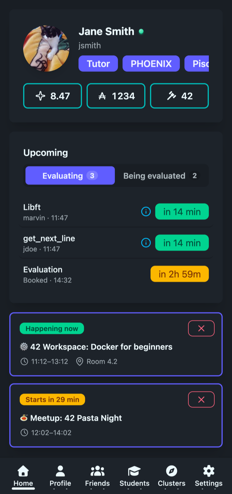
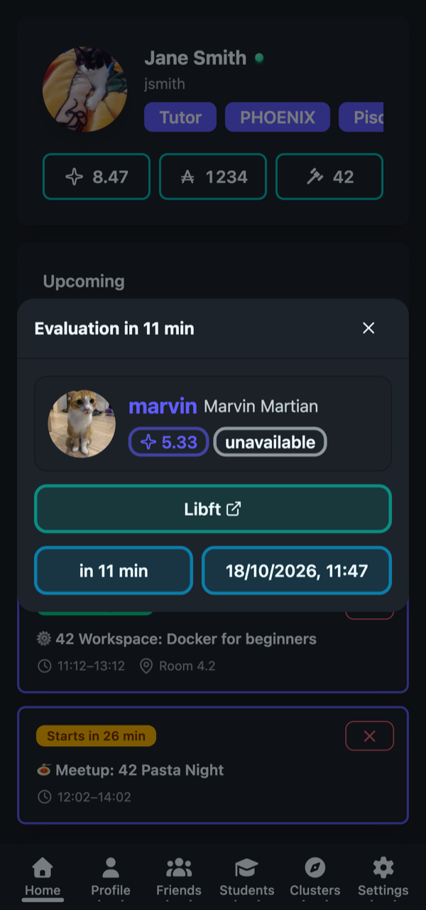
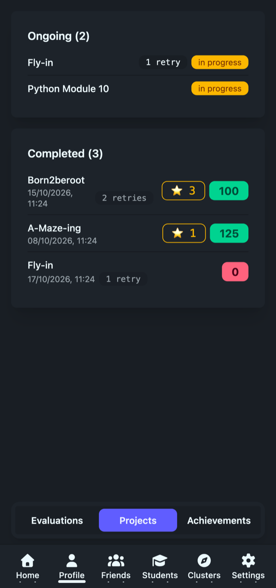
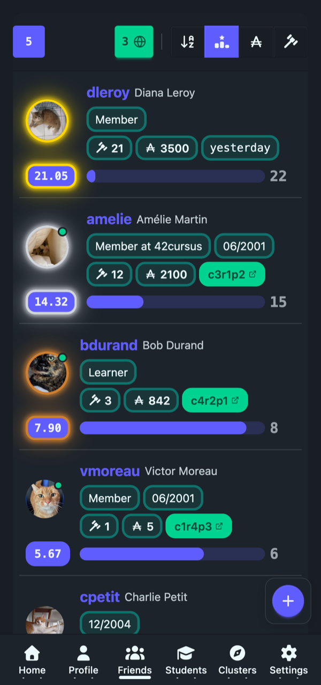
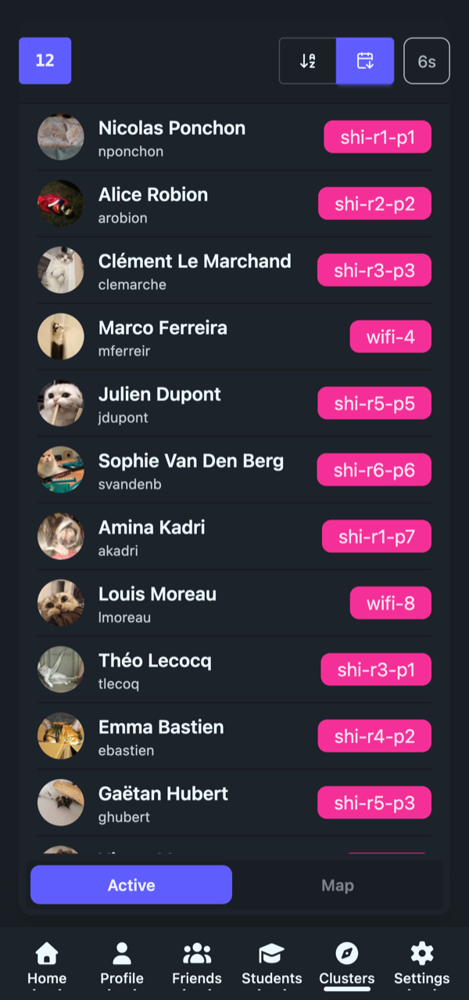

# Better Intra PWA

Better Intra on your phone: your 42 dashboard, profile, friends, the Belgium students directory, and evaluation notifications, right on your home screen.

**[mobile.betterintra.com](https://mobile.betterintra.com)**

---

*The Home tab: your profile, upcoming evaluations and 42 events.*

## Get it on your phone

Installing takes a few seconds, and then Better Intra opens from your home screen full screen, with no address bar, just like a normal app.

**iPhone / iPad**

1. Open [mobile.betterintra.com](https://mobile.betterintra.com) in **Safari**.
2. Tap the **Share** button.
3. Choose **Add to Home Screen**, then tap **Add**.

**Android**

1. Open [mobile.betterintra.com](https://mobile.betterintra.com) in **Chrome**.
2. Tap the **⋮** menu in the top-right corner.
3. Choose **Install app** (or **Add to Home Screen**).

Then open Better Intra from your home screen like any other app.

> **Easier way:** open the Better Intra extension, go to **Settings → Notifications**, and scan the QR code with your phone.

On your phone the site only works once it's installed. If you open it in a browser tab you'll see a short message telling you how to add it to your home screen.

**You need to already use Better Intra.** Sign in from the extension on your computer first; the app on your phone uses that same account.

## What you get

**🏠 Home**: your level, wallet and correction points, the evaluations coming up next, upcoming 42 events, and your project progress, all on one screen. Pull down to refresh.

**👤 Profile**: your projects, achievements and correction statistics, split into tabs.

**👥 Friends**: the same friends you track in the extension, with who's online, their level, wallet and correction points.

**🎓 Students** 🇧🇪: browse the Belgium student directory. Search, sort, filter by intake or status, and scroll through the whole list.

**🏫 Clusters** 🇧🇪: see which seats are taken right now, and who's sitting in them. Updates by itself every minute.

**🔔 Notifications**: get a push notification when you're booked to evaluate someone, 15 minutes before it starts, and when someone is assigned to evaluate you. Turn any of them off individually. There's a **Send test** button so you can check it works.

**🌗 Light & dark**: follows your phone's setting automatically, or pick one yourself.

**📶 Works offline**: the app opens without a connection and shows the last data it loaded, with a small indicator when you're offline.

**⚙️ Settings**: manage your signed-in devices, sign out, switch theme, and see a diagnostics panel with your connection, notification and storage status.

## Notes

- 🇧🇪 **Students** and **Clusters** are available to Belgium students for now. They'll come to more campuses later.
- **Profile pictures** show as initials at the moment. 42's image server blocks other websites from loading them, so the app shows a lettered placeholder instead.

## Screenshots

  
 

## Related

- [Better Intra extension](https://github.com/nicopasla/better-intra): the desktop browser extension this app is built alongside.
- [Better Intra Worker](https://github.com/nicopasla/better-intra-worker): the backend that powers sync and notifications.

## License

[MIT](./LICENSE)
